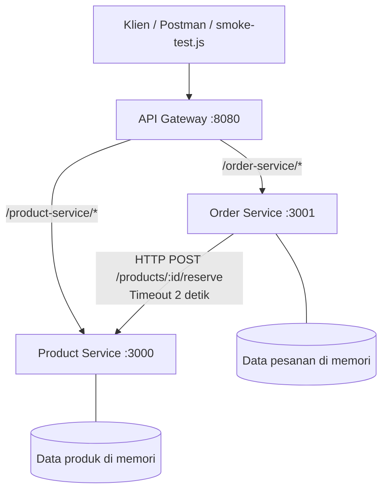

# Diagram Arsitektur

Aturan batas service:
- `product-service` adalah pemilik tunggal data produk dan stok.
- `order-service` adalah pemilik tunggal data pesanan.
- `order-service` tidak membaca atau mengubah array produk secara langsung. Ia meminta reservasi stok melalui HTTP.
- Jika `product-service` tidak tersedia, pembuatan pesanan membalas `503`, sedangkan daftar pesanan tetap dapat dibaca.
